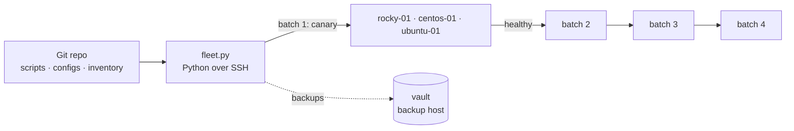

# Linux fleet automation

Patching, backups, log rotation and monitoring agent rollout for a **fleet of 12 Linux servers on three distros**, all done with Bash and Python over SSH.
Everything is driven from Git, and every job rolls out **canary first**, one batch at a time, so a bad change stops after three hosts instead of reaching the whole fleet.
It runs in a weekly maintenance window and on every push.

[Live pipeline →](https://danielkojomegbenu.com/projects/linux-fleet-automation)

## The fleet



| Batch | Rocky Linux 9 (RHEL) | CentOS Stream 9 | Ubuntu 24.04 |
|---|---|---|---|
| 1 · canary | rocky-01 | centos-01 | ubuntu-01 |
| 2 | rocky-02 | centos-02 | ubuntu-02 |
| 3 | rocky-03 | centos-03 | ubuntu-03 |
| 4 | rocky-04 | centos-04 | ubuntu-04 |

Each host is a container running sshd (no password logins, no root login), an `ops` user with sudo, and a stand-in for the revenue service: an HTTP API on :8080 that writes one log line per request.
The inventory is `inventory/fleet.toml`.

## The jobs

Each job runs batch by batch: one pipeline step per batch.
A failed host fails its step, so later batches never start.

| Job | What happens on each host | Fails when |
|---|---|---|
| **Preflight** | Reachable over SSH with a pinned host key, has more than 500 MB free, and the app is healthy | A host is unreachable or unhealthy |
| **Patch** | `dnf upgrade` or `apt-get upgrade`, then counts what's still pending and checks the app | Updates are still pending, or the app is down after patching |
| **Backup** | Streams a tarball of `/etc/revenue` and `/var/lib/revenue` to the vault, compares sha256 at both ends, restores `ledger.csv` from the backup and compares it with the live file, and keeps the 7 newest | The checksums differ, or the restore doesn't match |
| **Log rotation** | Pushes the logrotate config from Git, checks the host copy matches Git, rotates, then checks new requests land in the fresh `app.log` | The config drifted, or the app's logs are being lost |
| **Monitoring agent** | Copies the pinned node_exporter release, verifies its checksum, installs it, runs it as its own user, and scrapes `:9100/metrics` | The checksum is wrong, or no metrics come back |

The **fleet report** at the end (step summary plus a `fleet-report.json` artifact) shows every host against every job.

## See a bad change stop at the canary

Open the pull request **demo/logrotate-tidy-up**. It "tidies" the logrotate config by dropping `copytruncate`.
logrotate then renames the log out from under the app, which keeps writing to the old, now-deleted file. That's the classic way logs go missing.
The canary catches it on all three distros, and the rollout stops: batches 2-4 and the agent rollout never run.

## Run it on your machine (Linux)

```bash
bash fleet/fetch-agent.sh && bash fleet/start.sh
python3 fleet/fleet.py preflight
for job in patch backup rotate agent; do for b in 1 2 3 4; do python3 fleet/fleet.py $job --batch $b || break 2; done; done
python3 fleet/fleet.py report
docker compose down
```

## What's in the repo

| Path | What it is |
|---|---|
| `inventory/fleet.toml` | The 12 hosts, their distro and batch, and the vault |
| `fleet/fleet.py` | The orchestrator: runs a job on a batch over SSH in parallel, and writes the report |
| `scripts/` | The Bash jobs that run on each host: preflight, patch, rotate, agent |
| `configs/` | The logrotate config and the pinned agent version, both pushed from Git |
| `hosts/` | The host images (Rocky, CentOS Stream, Ubuntu) and the vault |
| `.github/workflows/fleet.yml` | The pipeline: weekly window plus every push |

## Cost

Free. Everything runs on the GitHub runner, and GitHub Actions is free for public repos.
